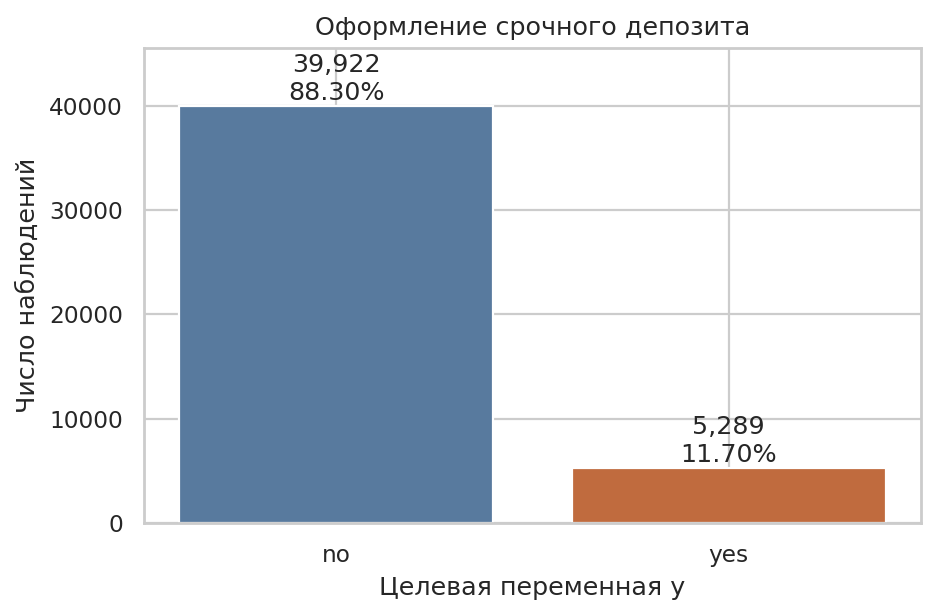
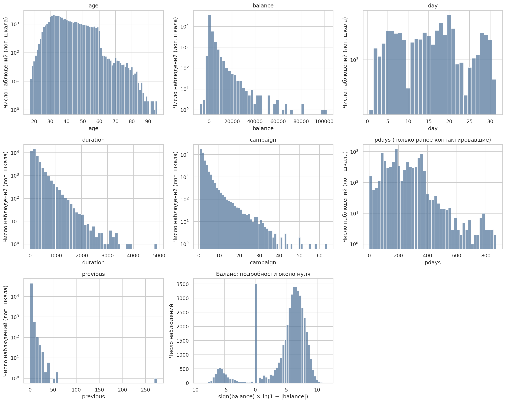
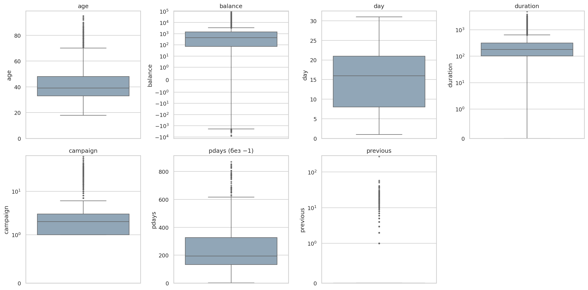
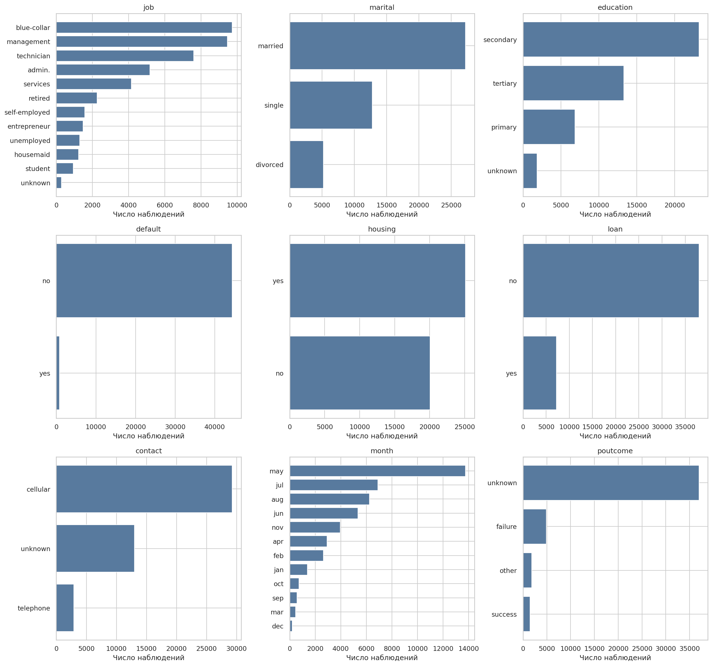
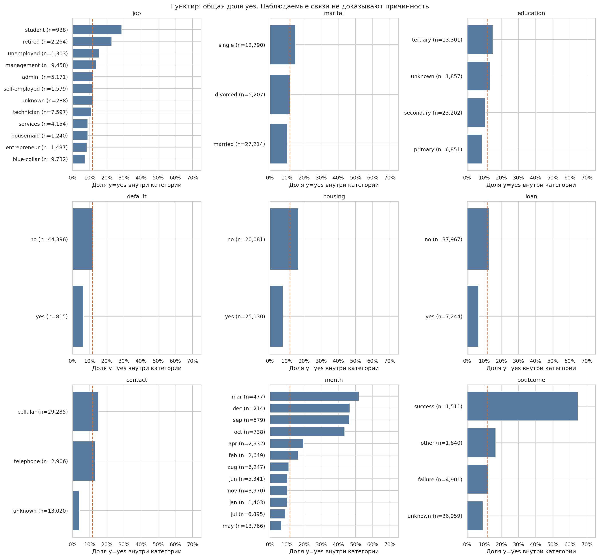
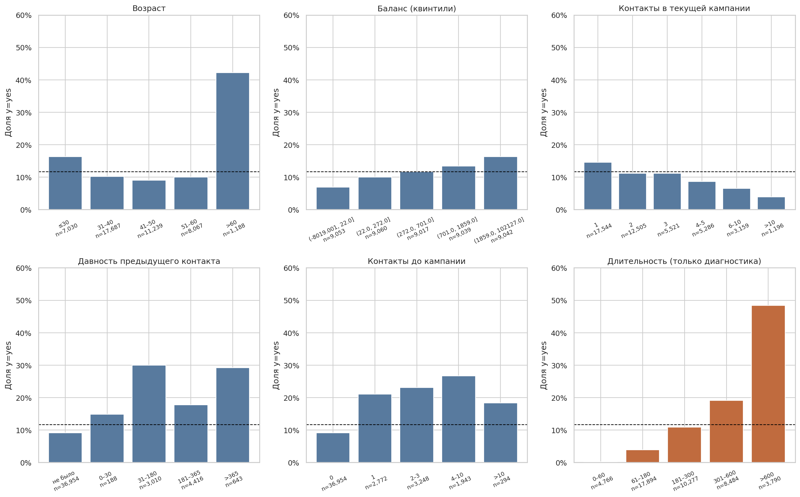
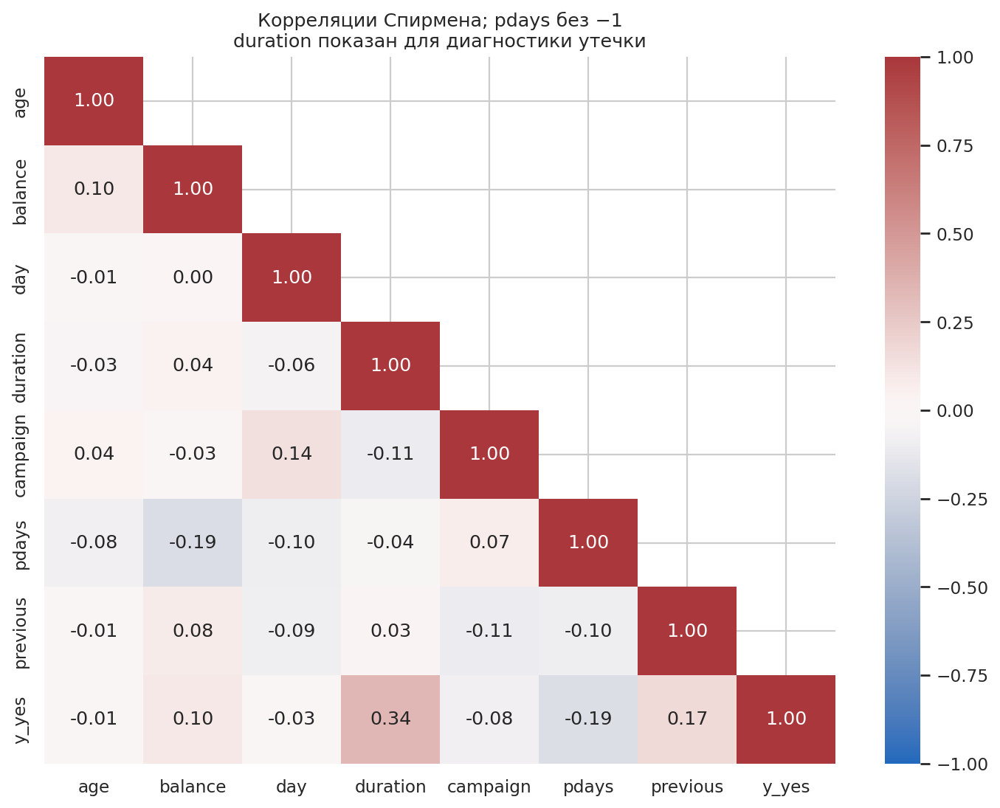
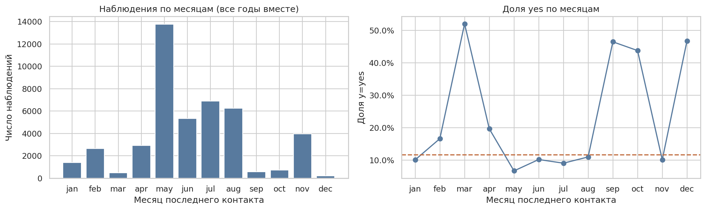
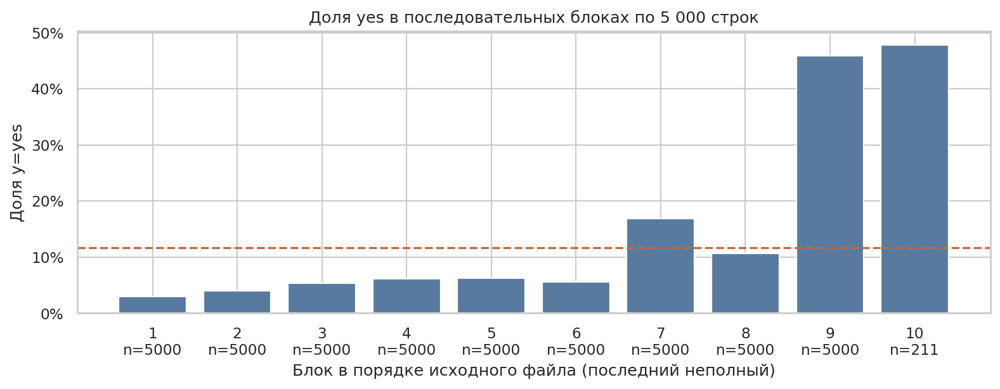

# Домашнее задание №1. Bank Marketing

Курс «Прикладное машинное обучение», ФТМИ ИТМО.

Работа выполнена по [заданию преподавателя](https://github.com/pacifikus/ftmi_ml_course/blob/master/HW/hw_1.md): постановка задачи, выбор метрик и разведочный анализ данных. Обучение модели в эту работу не входит. Все таблицы и графики получены на полном `bank-full.csv` запуском [eda.py](eda.py); исходные строки не удалялись и не изменялись.

## 1. Постановка задачи — 8 баллов

### Бизнес-проблема

Банк предлагает клиентам срочный депозит по телефону. Время операторов ограничено, а звонки клиентам, которые не заинтересованы в продукте, увеличивают стоимость кампании и могут вызывать раздражение. Задача — составлять приоритетный список клиентов перед началом обзвона, чтобы при том же количестве звонков получать больше оформленных депозитов.

ML может ранжировать клиентов по вероятности оформления депозита на основе сведений о клиенте и предыдущих кампаниях. Банк сможет сначала связываться с наиболее перспективными клиентами. Ожидаемая польза — рост конверсии выбранной группы и снижение числа звонков на один оформленный депозит; фактический эффект необходимо проверять в эксперименте.

### ML-задача и момент прогноза

Это бинарная классификация с оценкой вероятности положительного класса. Целевая переменная `y`: `yes` — клиент оформил срочный депозит, `no` — не оформил. Единица наблюдения — запись о клиенте и кампании с характеристиками последнего контакта, а не отдельный звонок; идентификатора клиента нет, поэтому считать все строки разными людьми нельзя.

Прогноз нужен **до первого звонка текущей кампании**. Для будущей модели исходными кандидатами будут восемь клиентских признаков (`age`, `job`, `marital`, `education`, `default`, `balance`, `housing`, `loan`) и три признака предыдущих кампаний (`pdays`, `previous`, `poutcome`). Их значения должны быть зафиксированы на дату решения: в частности, годовой баланс нельзя брать из периода, который ещё не закончился к моменту прогноза.

`duration` станет известен только после разговора и должен быть исключён. `campaign` включает последний звонок текущей кампании, поэтому для выбранного сценария его тоже исключаем. `day`, `month`, `contact` описывают фактически состоявшийся последний контакт и в таком виде в прогноз не входят. Плановую дату и канал можно будет использовать лишь после получения отдельного снимка информации, доступной до звонка. В EDA рассматриваются все исходные столбцы, чтобы увидеть ограничения и возможную утечку.

### Набор данных и достаточность

Источник — [Bank Marketing, UCI Machine Learning Repository](https://archive.ics.uci.edu/dataset/222/bank+marketing), DOI [10.24432/C5K306](https://doi.org/10.24432/C5K306). Использован [официальный архив](https://archive.ics.uci.edu/static/public/222/bank%2Bmarketing.zip), вложенный `bank.zip`, файл `bank-full.csv`. Это полная версия из **45 211 наблюдений и 17 столбцов: 16 входных признаков и один целевой**. Разделитель CSV — `;`. Не используются ни сокращённый `bank.csv`, ни другая версия `bank-additional-full.csv`.

Данные описывают телефонные кампании португальского банка. По [документации из архива](data/bank-names.txt), строки упорядочены по дате, период — май 2008 — ноябрь 2010. В CSV есть день и месяц последнего контакта, но нет года и полной даты.

В `bank-names.txt` создателями этой версии указаны **Paulo Cortez и Sérgio Moro**. Для неё приведена публикация: S. Moro, R. Laureano, P. Cortez. *Using Data Mining for Bank Direct Marketing: An Application of the CRISP-DM Methodology*. ESM'2011, pp. 117–121 ([публикация](https://hdl.handle.net/1822/14838)). Каталог UCI также указывает авторов S. Moro, P. Rita, P. Cortez и рекомендуемую ссылку на набор 2014 года. Лицензия UCI — [CC BY 4.0](https://creativecommons.org/licenses/by/4.0/); CSV в репозитории сохранён без изменений. Дата загрузки: 20.10.2026.

SHA-256 исходного CSV:

```text
d1513ec63b385506f7cfce9f2c5caa9fe99e7ba4e8c3fa264b3aaf0f849ed32d
```

В выборке 5 289 положительных примеров: этого достаточно для учебной постановки и последующего сравнения базовых моделей с небольшим числом признаков. Это не гарантирует достаточности для редких сегментов или переноса в другой банк.

Ограничения применимости:

- Данные одного банка и давнего периода могут не отражать современные продукты, клиентов и способы связи.
- В набор попали участники исторических кампаний. Их поведение не обязательно представляет всю клиентскую базу.
- Наблюдаемая подписка после кампании не равна причинному эффекту звонка. Нет контрольной группы, сумм депозитов, прибыли и стоимости контактов, поэтому финансовый эффект из этого CSV посчитать нельзя.
- Нет идентификатора клиента и полной даты: трудно исключить пересечение клиентов между частями выборки и строго восстановить временные срезы.
- Возраст, профессия и семейное положение требуют проверки качества прогнозов по группам и обоснованности применения в рабочем процессе.

**Вывод.** Датасет подходит для учебной бинарной классификации и анализа отклика, но до обучения нужно согласовать момент прогноза и доступность каждого признака. Выводы EDA описывают историческую выборку, а не доказывают полезность обзвона для конкретного клиента.

## 2. Выбор метрик — 8 баллов

**Основная метрика — Average Precision (AP), сводная метрика precision–recall для ранжирования.** При доле `yes` 11,70% она позволяет оценивать выделение клиентов с депозитом без доминирования многочисленных `no`; дополнительно при доступном банку бюджете в `k` звонков нужны Precision@k и Recall@k, поскольку FP расходует время оператора и бюджет, а FN означает упущенную возможность привлечь депозит.

Это основное обоснование из двух предложений. Определение AP — сумма значений precision, взвешенных приростами recall, без трапецеидальной интерполяции ([определение метрики](https://scikit-learn.org/stable/modules/generated/sklearn.metrics.average_precision_score.html)). Значение AP здесь не рассчитывается: прогнозов модели в ДЗ №1 нет.

Для будущего списка из `k` клиентов Precision@k — доля оформивших депозит среди выбранных, Recall@k — доля найденных положительных примеров среди всех положительных. При фиксированном `k` рост Precision@k означает больше депозитов на тот же объём обзвона. Размер `k` должен задаваться реальной пропускной способностью операторов. AP оценивает весь порядок клиентов и сама по себе не гарантирует лучший результат именно на выбранном `k`, поэтому обе дополнительные метрики нужны при сравнении моделей.

| Ошибка | Смысл в задаче | Последствие |
| --- | --- | --- |
| FP | Выбран клиент с историческим `y=no` | Расход на контакт и возможное раздражение без оформления депозита |
| FN | Пропущен клиент с историческим `y=yes` | Упущенная возможность привлечь депозит |

Денежная стоимость ошибок и их соотношение неизвестны. После получения затрат и маржи банк сможет выбирать размер списка или порог по ожидаемой прибыли и проверять эффект в A/B-тесте. Precision и recall на исторических метках будут приближёнными показателями, поскольку сокращение и изменение кампании может менять поведение клиентов.

Класс `no` содержит 39 922 записи (88,30%), `yes` — 5 289 (11,70%); соотношение примерно 7,55:1. Правило «всегда no» даёт Accuracy 88,30% и Recall 0%, поэтому Accuracy не подходит как основная метрика. Для случайного отбора ожидаемая доля `yes` в списке составляет 11,70% на этой выборке: это ориентир для Precision@k, а не результат обученной модели.

**Вывод.** Основное сравнение будущих моделей — по AP, практическая проверка списка обзвона — по Precision@k и Recall@k. Порог и финансовую выгоду нельзя обосновать без данных банка о ресурсах и затратах.

## 3. Разведочный анализ — 14 баллов

### 3.1. Размер, структура и типы

В исходном DataFrame 45 211 строк, семь числовых столбцов `int64` и десять строковых `object`, включая `y`. Категориальные признаки пока не закодированы. Значения и описания ниже относятся именно к версии `bank-full.csv`.

| Столбец | Тип pandas | Уникальных значений | Содержание |
| --- | --- | ---: | --- |
| age | int64 | 77 | Возраст, лет |
| job | object | 12 | Профессия |
| marital | object | 3 | Семейное положение; divorced включает вдовство |
| education | object | 4 | Уровень образования |
| default | object | 2 | Просроченный кредит: yes/no |
| balance | int64 | 7 168 | Среднегодовой баланс, евро |
| housing | object | 2 | Жилищный кредит: yes/no |
| loan | object | 2 | Потребительский кредит: yes/no |
| contact | object | 3 | Канал последнего контакта |
| day | int64 | 31 | День месяца последнего контакта |
| month | object | 12 | Месяц последнего контакта |
| duration | int64 | 1 573 | Длительность последнего разговора, секунд |
| campaign | int64 | 48 | Число контактов текущей кампании, включая последний |
| pdays | int64 | 559 | Дней после контакта в предыдущей кампании; −1 — контакта не было |
| previous | int64 | 41 | Число контактов до текущей кампании |
| poutcome | object | 4 | Исход предыдущей кампании |
| y | object | 2 | Оформлен ли депозит: yes/no |

**Вывод.** Числовой тип не всегда означает обычную непрерывную величину: `day` — календарный признак, а `pdays` содержит специальный код. Для будущей модели нужны отдельная обработка этих полей и кодирование категорий; целевая переменная не должна попадать в признаки.

### 3.2. Пропуски, unknown и дубликаты

`isna()` не обнаруживает ни одного пропуска во всех 17 столбцах. Пустых строк в строковых столбцах нет. Полных дубликатов — 0; повторов по всем 16 входным признакам — тоже 0. Это не доказывает отсутствия повторных клиентов, поскольку их ID неизвестны.

| Признак | unknown, записей | Доля от всех строк |
| --- | ---: | ---: |
| job | 288 | 0,64% |
| education | 1 857 | 4,11% |
| contact | 13 020 | 28,80% |
| poutcome | 36 959 | 81,75% |

Хотя бы одно `unknown` есть у 37 369 строк (82,65%). Это строковая категория, поэтому `isna()` её не считает. У 36 954 записей одновременно `pdays=-1`, `previous=0` и `poutcome=unknown`: здесь неизвестный результат объясняется отсутствием предыдущего контакта. Ещё у пяти записей `poutcome=unknown` при наличии истории контактов; это отдельная неполнота информации.

**Вывод.** Удаление всех строк с `unknown` уничтожит большую часть данных и особенно клиентов без истории. Сохраним такие состояния отдельными категориями; для `poutcome` различим отсутствие предыдущей кампании и неизвестный результат при наличии истории. Числовое заполнение средним здесь не подходит, удалять дубликаты по результатам проверки не требуется.

### 3.3. Целевая переменная

| y | Наблюдений | Доля |
| --- | ---: | ---: |
| no | 39 922 | 88,30% |
| yes | 5 289 | 11,70% |



**Вывод.** Большинство клиентов в выборке не оформило депозит. При последующей оценке нужны метрики положительного класса и контроль доли `yes` в каждом временном отрезке. Возможное взвешивание классов следует проверять только на обучающей части, а проверочную часть сохранять с естественным распределением.

### 3.4. Числовые признаки

Для каждого признака `count=45 211`; стандартное отклонение рассчитано pandas с `ddof=1`.

| Признак | Среднее | Ст. отклонение | Min | Q1 | Медиана | Q3 | Max |
| --- | --- | --- | --- | --- | --- | --- | --- |
| age | 40,94 | 10,62 | 18 | 33 | 39 | 48 | 95 |
| balance | 1 362,27 | 3 044,77 | -8 019 | 72 | 448 | 1 428 | 102 127 |
| day | 15,81 | 8,32 | 1 | 8 | 16 | 21 | 31 |
| duration | 258,16 | 257,53 | 0 | 103 | 180 | 319 | 4 918 |
| campaign | 2,76 | 3,10 | 1 | 1 | 2 | 3 | 63 |
| pdays | 40,20 | 100,13 | -1 | -1 | -1 | -1 | 871 |
| previous | 0,58 | 2,30 | 0 | 0 | 0 | 0 | 275 |

Для `pdays` общая статистика выше включает специальное значение −1 и не описывает средний срок с предыдущего контакта. Контакт ранее был у **8 257 наблюдений (18,26%)**, не был — у 36 954 (81,74%). В подвыборке с историей `pdays` лежит от 1 до 871 дня: среднее 224,58, медиана 194, Q1=133, Q3=327, стандартное отклонение 115,34. Противоречий между `pdays=-1` и `previous=0` не обнаружено.

На гистограммах показан полный диапазон значений; ось частот логарифмическая, кроме дополнительной гистограммы баланса. Для `pdays` здесь и на boxplot оставлены только записи с предыдущим контактом. Дополнительная гистограмма использует `sign(balance) × ln(1 + |balance|)`, чтобы одновременно показать отрицательные значения, нули и правый хвост. Это преобразование только для визуализации.



**Вывод.** У `balance`, `duration`, `campaign` и `previous` длинные правые хвосты. Средний баланс 1 362,27 евро заметно выше медианы 448 евро, поэтому одного среднего недостаточно. Для линейных моделей можно проверить масштабирование и устойчивое к выбросам преобразование баланса; обычный логарифм не подходит из-за отрицательных значений. Для `pdays` нужен флаг наличия истории, а давность следует хранить отдельно от −1. Параметры будущих преобразований необходимо оценивать на обучающей части.

### 3.5. Выбросы и аномалии

На boxplot для баланса и счётчиков с длинным хвостом используется симметричная логарифмическая шкала. Границы выбросов рассчитаны на исходных значениях как `[Q1 − 1,5 × IQR; Q3 + 1,5 × IQR]`; для `pdays` — только по записям с историей.



| Признак | Размер подвыборки | Нижняя граница | Верхняя граница | За границами | Доля |
| --- | --- | --- | --- | --- | --- |
| age | 45 211 | 10,5 | 70,5 | 487 | 1,08% |
| balance | 45 211 | -1 962,0 | 3 462,0 | 4 729 | 10,46% |
| day | 45 211 | -11,5 | 40,5 | 0 | 0,00% |
| duration | 45 211 | -221,0 | 643,0 | 3 235 | 7,16% |
| campaign | 45 211 | -2,0 | 6,0 | 3 064 | 6,78% |
| pdays | 8 257 | -158,0 | 618,0 | 49 | 0,59% |
| previous | 45 211 | 0,0 | 0,0 | 8 257 | 18,26% |

Отрицательный баланс есть у 3 766 наблюдений, нулевой — у 3 514. Отрицательный баланс может быть допустимым состоянием счёта; сам по себе он не доказывает ошибку. Возраст находится в диапазоне 18–95 лет, `day` — 1–31, `campaign` не меньше 1, `previous` неотрицателен, значений `pdays` меньше −1 нет. Это проверки отдельных диапазонов, а не полноценная проверка календарных дат.

У трёх строк `duration=0`; без журналов звонков нельзя решить, был ли это несостоявшийся контакт или ошибка записи. Максимум `previous=275` резко отделён от следующего значения 58; максимум `campaign=63` тоже требует уточнения бизнес-смысла повторных контактов. Максимальная длительность — 4 918 секунд.

**Вывод.** IQR выявляет крайние значения, но не определяет ошибочные записи. Например, у `previous` Q1=Q3=0, поэтому правило отмечает все 8 257 ненулевых значений, хотя это содержательная история контактов. Автоматически удалять такие строки нельзя. Крайние значения нужно сверить с источником; ограничение хвостов и масштабирование сравнить при дальнейшем моделировании, сохранив исходный CSV. `duration` из будущих признаков исключается независимо от выбросов.

### 3.6. Категориальные признаки

| Признак | Категорий | Самая частая категория | Наблюдений | Доля |
| --- | --- | --- | --- | --- |
| job | 12 | blue-collar | 9 732 | 21,53% |
| marital | 3 | married | 27 214 | 60,19% |
| education | 4 | secondary | 23 202 | 51,32% |
| default | 2 | no | 44 396 | 98,20% |
| housing | 2 | yes | 25 130 | 55,58% |
| loan | 2 | no | 37 967 | 83,98% |
| contact | 3 | cellular | 29 285 | 64,77% |
| month | 12 | may | 13 766 | 30,45% |
| poutcome | 4 | unknown | 36 959 | 81,75% |

График показывает частоты всех категорий каждого из девяти строковых входных признаков.



**Вывод.** Категории представлены неравномерно: например, `job=unknown` содержит всего 288 строк, а самый частый месяц — май, 13 766 строк. У `default` положительное состояние редкое: 815 строк. При кодировании нужно поддержать категории, отсутствующие в обучающей части; произвольные целочисленные коды не должны задавать ложный порядок профессий и каналов. Для базового решения подойдёт one-hot-кодирование с сохранением `unknown`.

### 3.7. Категории и оформление депозита

Здесь доля `yes` — число положительных исходов внутри группы, делённое на размер этой же группы. Пунктир показывает общую долю 11,70%; `n` — число наблюдений в категории. График включает все девять категориальных входных признаков.



| Группа | Наблюдений | yes | Доля yes |
| --- | --- | --- | --- |
| job=student | 938 | 269 | 28,68% |
| job=retired | 2 264 | 516 | 22,79% |
| job=blue-collar | 9 732 | 708 | 7,27% |
| education=tertiary | 13 301 | 1 996 | 15,01% |
| marital=single | 12 790 | 1 912 | 14,95% |
| default=yes | 815 | 52 | 6,38% |
| housing=yes | 25 130 | 1 935 | 7,70% |
| housing=no | 20 081 | 3 354 | 16,70% |
| loan=yes | 7 244 | 484 | 6,68% |
| loan=no | 37 967 | 4 805 | 12,66% |
| contact=unknown | 13 020 | 530 | 4,07% |
| poutcome=success | 1 511 | 978 | 64,73% |
| poutcome=failure | 4 901 | 618 | 12,61% |

У `poutcome=success` доля `yes` составляет 64,73%, но таких записей всего 1 511. У студентов и пенсионеров она выше общей, у `blue-collar` — ниже. Это может отражать состав клиентов и прежнюю политику кампаний. При `housing=yes` доля ниже, чем при `housing=no`; такая же направленность наблюдается для потребительского кредита. Нельзя на этом основании утверждать, что наличие кредита причинно снижает интерес к депозиту.

**Вывод.** История успешных кампаний и клиентские категории потенциально полезны для прогноза. Перед практическим использованием нужно проверить устойчивость различий во времени и на новых данных. Малые группы и связи между профессией, возрастом и историей кампаний не позволяют интерпретировать эти доли как независимые эффекты.

### 3.8. Числовые признаки и целевая переменная

| Класс y (медианы) | age | balance | day | duration | campaign | pdays | previous |
| --- | --- | --- | --- | --- | --- | --- | --- |
| no | 39 | 417 | 16 | 164 | 2 | -1 | 0 |
| yes | 38 | 733 | 15 | 426 | 2 | -1 | 0 |

Ниже возраст разбит на интервалы, баланс — на квинтили, остальные показатели — на явно заданные группы. Все границы и размеры групп выводятся `eda.py`. Разбиение нужно для описания формы связи; готовые правила для будущей модели из него не следуют.



| Группа | Наблюдений | yes | Доля yes |
| --- | --- | --- | --- |
| Возраст ≤30 | 7 030 | 1 145 | 16,29% |
| Возраст >60 | 1 188 | 502 | 42,26% |
| Баланс ≤22 евро (нижний квинтиль) | 9 053 | 630 | 6,96% |
| Баланс >1 859 евро (верхний квинтиль) | 9 042 | 1 480 | 16,37% |
| campaign=1 | 17 544 | 2 561 | 14,60% |
| campaign>10 | 1 196 | 47 | 3,93% |
| Предыдущего контакта не было | 36 954 | 3 384 | 9,16% |
| Предыдущий контакт был | 8 257 | 1 905 | 23,07% |

Доля `yes` у клиентов старше 60 лет — 42,26%, хотя ранговая корреляция возраста с целью близка к нулю. Это пример нелинейной зависимости. В группе с одним контактом текущей кампании доля `yes` выше, чем при более чем десяти контактах; возможное объяснение — неудачные попытки приводят к повторным звонкам, поэтому делать вывод «повторный звонок снижает вероятность подписки» нельзя.

У `duration` медиана 426 секунд для `yes` и 164 для `no`. Для разговоров дольше 600 секунд доля `yes` равна 48,36%, для 0–60 секунд — 0,19%. Связь сильная, но длительность появляется после начала контакта и не может помогать выбрать клиента до звонка.

**Вывод.** Важны нелинейные связи и наличие истории контактов. `duration` исключаем, `campaign` для выбранного сценария также исключаем. Сравнение долей по группам не заменяет проверку будущей модели и не позволяет рекомендовать увеличение длительности разговора или числа попыток.

### 3.9. Взаимосвязи признаков

Для числовых столбцов и индикатора `y_yes` рассчитаны корреляции Спирмена. Перед расчётом `pdays=-1` заменён на `NaN` только в копии для корреляционного анализа: все пары с `pdays` используют 8 257 наблюдений с историей, остальные пары — все 45 211. Исходный DataFrame не меняется.



Корреляции с целью: `duration` — 0,342, `previous` — 0,169, `balance` — 0,100, `campaign` — −0,084, `age` — −0,009. Для `pdays` среди ранее контактировавших — −0,186. Среди самих числовых входных признаков сильных парных монотонных связей на графике не видно. При этом `pdays=-1` полностью совпадает с отсутствием прошлых контактов, а `poutcome=unknown` почти полностью объясняется этим состоянием.

**Вывод.** Низкая корреляция не означает бесполезность признака: она не видит некоторые нелинейные связи и не анализирует категории. Проверять избыточность истории контактов и значимость признаков нужно совместно, а не отбирать столбцы по одному порогу корреляции. Сильная связь `duration` с целью не отменяет ограничения на его доступность.

### 3.10. Месяцы и порядок строк



В мае 13 766 записей и доля `yes` 6,72%; в марте — 477 записей и 51,99%, в декабре — 214 и 46,73%. Месяцы объединяют разные годы, а группы сильно отличаются по размеру. Эти различия нельзя интерпретировать как чистую сезонность.

В `contact=unknown` 13 020 записей, из них 7 975 относятся к маю и 4 532 к июню. Следовательно, неизвестный канал связан с составом кампаний и календарём; его низкая доля `yes` не доказывает влияние самого канала.



В первых 5 000 строк доля `yes` равна 3,02%, в строках 40 001–45 000 — 45,84%, в последних 211 — 47,87%. Порядок строк, по документации, хронологический, однако точные периоды этих блоков без полной даты определить нельзя. Последний блок мал и сам по себе не характеризует устойчивую тенденцию.

**Вывод.** В данных заметен сдвиг распределения исходов между последовательными частями файла. При дальнейшем обучении нужно проверять перенос на более поздние наблюдения, а не полагаться только на случайное разбиение. Деление по порядку строк возможно как приближение, но предпочтительны полные даты и ID клиентов, чтобы контролировать время и пересечение людей.

## 4. Общий вывод и дальнейшая работа

В полном наборе 45 211 записей нет формальных пропусков и полных дубликатов, но есть существенный дисбаланс классов, специальные состояния `unknown` и −1, длинные хвосты и изменение доли положительных исходов по порядку строк. Наиболее заметные различия связаны с результатом предыдущей кампании, возрастными группами, балансом и контекстом контактов. Длительность разговора связана с результатом, но недоступна в момент выбранного решения.

Дальнейший план:

1. Получить ID клиентов, полные даты и снимки признаков до кампании; уточнить единицу наблюдения и крайние значения счётчиков. Согласовать бюджет обзвона и данные о затратах и марже.
2. Отложить более поздние данные для итоговой проверки с контролем повторных клиентов. Все параметры предобработки оценивать внутри обучающей части; для уже изученного набора учитывать, что EDA использовала все строки.
3. Исключить `duration`, `campaign` и поля фактического последнего контакта для отбора до начала кампании. Проверить доступность клиентских сведений и истории на дату решения.
4. Отделить наличие истории от значения `pdays`, сохранить смысл `unknown`, закодировать категории. Не удалять хвосты автоматически; сравнить разумные преобразования и масштабирование.
5. В следующей работе сравнить простые модели по AP и Precision@k/Recall@k на одинаковом бюджете, с ориентиром на случайный отбор. Проверить устойчивость по времени и клиентским группам.
6. Оценить прирост депозитов и стоимость привлечения в контролируемом эксперименте. Историческая классификация сама по себе не доказывает бизнес-эффект.

## 5. Воспроизведение

Проверенная версия Python — **3.12.14**. Зависимости: pandas 2.2.3, numpy 2.1.3, matplotlib 3.9.2, seaborn 0.13.2. `scikit-learn` не используется, поскольку здесь нет обучения и расчёта метрик по прогнозам.

Из корня репозитория:

```bash
python3.12 -m venv .venv
source .venv/bin/activate
python -m pip install -r requirements.txt
python -m pip check
python eda.py
```

В Windows активация: `.venv\Scripts\activate`. Повторная загрузка данных не требуется: исходный CSV уже находится в `data/`. Скрипт печатает статистики и групповые таблицы, создаёт девять PNG в `figures/`. Пути определяются относительно самого `eda.py`. Для построения используется backend `Agg`, поэтому графическое окно не требуется. Локальные `.venv` и `.mplconfig` исключены из Git.

Структура:

```text
ml-homework-1/
├── README.md
├── eda.py
├── requirements.txt
├── .gitignore
├── data/
│   ├── bank-full.csv
│   └── bank-names.txt
└── figures/
    └── 01_target.png ... 09_row_order.png
```

Проверка перед публикацией: зависимости установлены в новое изолированное окружение, `pip check` не обнаружил конфликтов, `eda.py` выполнен из корня проекта с кодом выхода 0. Получены девять PNG; изображения просмотрены, ссылки README на локальные файлы проверены, числовые таблицы и выводы сверены с фактическими вычислениями. Данные сверены с CSV из официального архива по SHA-256.

## 6. Соответствие критериям оригинального задания

| Критерий | Максимум | Где выполнен |
| --- | ---: | --- |
| Бизнес-постановка | 3 | Раздел 1: ограничение ресурсов и приоритетный обзвон |
| ML-постановка | 2 | Раздел 1: бинарная классификация, цель и момент прогноза |
| Достаточный набор данных | 3 | Раздел 1: полный CSV, источник, авторы, размер и ограничения |
| Предложенная метрика | 3 | Раздел 2: AP и дополнительные метрики при бюджете k |
| Корректное обоснование метрики | 5 | Раздел 2: два предложения, дисбаланс, FP/FN и бизнес-цель |
| Базовые характеристики и статистики | 3 | Разделы 3.1–3.6 |
| Релевантные визуализации | 5 | Девять графиков в разделах 3.3–3.10 |
| Интерпретации и рекомендации по работе с данными | 6 | Выводы после блоков EDA и план в разделе 4 |
| **Всего** | **30** | Все критерии рассмотрены; итоговую оценку выставляет преподаватель |
